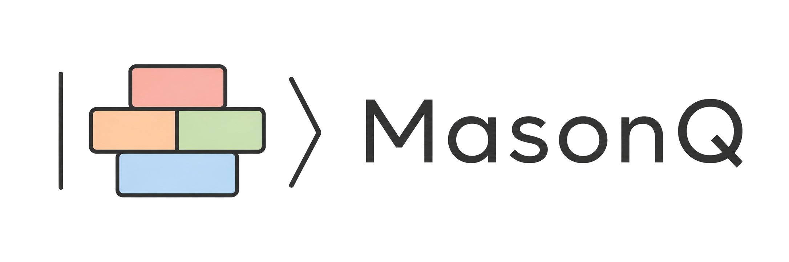

[//]: # (![Logo]&#40;images/masonQ_nobg.png&#41;)


[](https://github.com/Nonsens24/brickwork_transpiler/actions)
[](https://app.codecov.io/gh/Nonsens24/brickwork_transpiler)
[](#)
[](https://www.python.org/)
[](#)
[](docs/README.md)
[](https://black.readthedocs.io/)
[](http://mypy-lang.org/)
[](https://docs.pytest.org/)

MasonQ is a layout-aware transpiler from unitary Qiskit circuits to brickwork
measurement-based quantum computation patterns. It lowers circuits to a
brickwork-compatible `rz`/`rx`/`cx` basis, schedules them onto a brickwork
instruction matrix, builds the corresponding graph, and emits a Graphix pattern
with measurement angles.

The project is research-grade and currently alpha quality: the core pipeline is
covered by unit and integration tests, while slower end-to-end Graphix/Qiskit
statevector checks live in `tests/system_tests`.

## Installation

For the clean user install:

```bash
pip install masonq
```

This installs the normal scientific stack most users need: Qiskit, Graphix,
plotting support, tensor-network simulation helpers, Aer/Qiskit algorithms for
examples, and pandas/scipy for research workflows.

From a local checkout during development:

```bash
git clone https://github.com/Nonsens24/brickwork_transpiler.git
cd brickwork_transpiler
python -m pip install -e .
```

Only two extras should normally matter:

```bash
python -m pip install -e ".[ibm]"          # optional IBM cloud/backend access for your own scripts
python -m pip install -e ".[dev]"          # pytest, coverage, formatting, typing, pre-commit
```

`ibm` is intentionally separate. MasonQ's core transpiler, Graphix simulation,
and local Qiskit reference checks do not call IBM Runtime. Install this extra
only if your own scripts need `qiskit-ibm-runtime` to authenticate with IBM
Quantum services or query cloud backends.

Use `qiskit-ibm-runtime` for IBM access. Do not install the deprecated
`qiskit-ibm-provider` or `qiskit-ibmq-provider` packages in new environments.

For development on the full repository:

```bash
python -m pip install -e ".[dev,ibm]"
```

## Quick Start

```python
from qiskit import QuantumCircuit
from qiskit.quantum_info import Statevector

from brickwork_transpiler import transpile

qc = QuantumCircuit(2)
qc.h(0)
qc.cx(0, 1)

input_state = Statevector.from_label("++")

result = transpile(
    qc,
    input_state,
    routing_method="sabre",
    layout_method="trivial",
    with_ancillas=True,
    return_result=True,
)

result.plot(save_path="images/graphs/quickstart.pdf", show=False)
verification = result.verify()
print(result.resources)
print(verification.equivalent, verification.fidelity)
```

`transpile(...)` does not simulate automatically. It constructs and validates
the brickwork pattern. Simulation happens only when you explicitly call
`result.simulate_statevector()` or `result.verify()`.

## Simulation And Reference Checks

The actual brickwork/MBQC object is the Graphix pattern:

```python
pattern = result.pattern
```

To simulate the brickwork pattern with Graphix:

```python
brickwork_state = result.simulate_statevector(
    backend="tensornetwork",
    graph_prep="parallel",
    seed=0,
)
```

To compare that Graphix result against a layout-aware Qiskit statevector
reference:

```python
verification = result.verify(tolerance=1e-8)

print(verification.equivalent)
print(verification.fidelity)
```

For advanced debugging, the Qiskit reference can be computed directly from the
original circuit, the Graphix output ordering, and the decomposed Qiskit circuit:

```python
from brickwork_transpiler import utils

reference_state = utils.calculate_ref_state_from_qiskit_circuit(
    result.pattern,
    qc,
    result.decomposed_circuit,
    input_state,
)
```

Use `verify()` for normal correctness checks. It runs both sides consistently
and handles the output-order comparison used by the package.

If you want to inspect or reproduce the comparison yourself:

```python
brickwork_state = result.simulate_statevector()
qiskit_reference = result.qiskit_reference_statevector()
permutation = result.output_permutation()

print(permutation)
```

`output_permutation()` is the qubit permutation that maps the decomposed Qiskit
circuit output order into Graphix's output statevector order. This is the
important piece when `layout_method` is not trivial.

## Layout Methods And Verification

MasonQ supports Qiskit layout/routing choices through the normal Qiskit
arguments:

```python
result = transpile(
    qc,
    input_state,
    routing_method="sabre",
    layout_method="sabre",
    return_result=True,
)
```

The recommended choices are:

- `layout_method="trivial"` for debugging and deterministic logical-to-row
  interpretation;
- `layout_method="sabre"` for realistic line-layout routing experiments;
- `routing_method="sabre"` for nontrivial circuits on the line coupling map.

For verification, MasonQ compares the Graphix simulation with the decomposed
Qiskit circuit after Qiskit's layout and routing have already been applied.
It then permutes the Qiskit reference into Graphix output order. This means
`result.verify()` can be used with nontrivial layout methods for supported
circuits:

```python
verification = result.verify(tolerance=1e-8)
assert verification.equivalent
```

For manual checks, compare `result.simulate_statevector()` with
`result.qiskit_reference_statevector()`. Both are returned in Graphix output
order.

## Current Public Pipeline

New code should call `transpile(..., return_result=True)` and work with the
structured `TranspileResult` object:

```python
from brickwork_transpiler import transpile

result = transpile(
    qc,
    input_state,
    routing_method="sabre",
    layout_method="trivial",
    with_ancillas=True,
    opt=3,
    fallback_opt=1,
    multi_control_strategy="hls",
    return_result=True,
)

pattern = result.pattern
decomposed_qc = result.decomposed_circuit
resources = result.resources
```

The public object exposes the normal workflow:

- `result.pattern`: the Graphix brickwork pattern;
- `result.decomposed_circuit`: the Qiskit circuit after decomposition, layout,
  and routing into MasonQ's supported basis;
- `result.resources`: rows, brick columns, graph depth, graph nodes, and
  decomposed circuit metrics;
- `result.plot(...)`: safe plotting wrapper;
- `result.simulate_statevector(...)`: explicit Graphix simulation;
- `result.qiskit_reference_statevector(...)`: layout-aware Qiskit reference in
  Graphix output order;
- `result.output_permutation()`: Qiskit-output to Graphix-output qubit order;
- `result.verify(...)`: explicit Graphix/Qiskit statevector check;
- `result.save_pattern_text(...)`: write the Graphix pattern representation.

`transpile(...)` itself constructs, validates, and returns data. It does not
simulate unless you explicitly call `result.simulate_statevector()` or
`result.verify()`.

## Intermediate Stage Returns

For large sweeps you often do not need a full Graphix pattern. Use
`return_stage` to stop early:

```python
resources = transpile(qc, return_stage="resources")
matrix = transpile(qc, return_stage="matrix")
sparse_matrix = transpile(qc, return_stage="sparse_matrix")
decomposed_qc = transpile(qc, return_stage="decomposed_circuit")
```

The main scheduler objective is minimal graph depth:

```text
graph_depth = 4 * brick_columns + 1
```

`resources.graph_depth` reports this objective directly.

Use `return_stage="sparse_matrix"` when you want the aligned brick instruction
matrix without storing every empty row/column cell. The sparse object keeps the
same dimensions and stores only non-empty cells:

```python
sparse = transpile(qc, return_stage="sparse_matrix")

print(sparse.shape)
print(sparse.non_empty_cells)
print(sparse.occupancy)

for row, column, instructions in sparse.iter_non_empty():
    ...
```

Call `sparse.to_dense()` if you need the legacy dense `matrix[row][column]`
form for debugging.

See [Sparse instruction matrix](docs/sparse_matrix.md) for the complete API and
dense-versus-sparse guidance.

For timing comparisons while developing the scheduler:

```bash
python benchmarks/benchmark_graph_depth.py
```

## Legacy Compatibility

These interfaces are still supported so old notebooks and experiments keep
running, but they are not the recommended API for new code.

The historical default return is tuple-unpackable:

```python
pattern, colour_map, decomposed_qc = transpile(
    qc,
    input_vector=None,
    routing_method="sabre",
    layout_method="trivial",
    with_ancillas=True,
    opt=3,
    fallback_opt=1,
    multi_control_strategy="hls",
)
```

Prefer this instead:

```python
result = transpile(qc, input_vector, return_result=True)
pattern = result.pattern
colour_map = result.colour_map
decomposed_qc = result.decomposed_circuit
```

Legacy names and flags:

- `return_mat=True` is equivalent to `return_stage="matrix"`;
- `return_stage="instruction_matrix"` is an alias for `return_stage="matrix"`;
- `result.transpiled_circuit` remains as an alias for
  `result.decomposed_circuit`, but new code should use
  `decomposed_circuit` because the circuit has been decomposed/routed, not
  converted into the final brickwork pattern.

## Decomposition Policy

`multi_control_strategy="hls"` uses Qiskit's current high-level synthesis path
for multi-controlled gates. For reproducing older experiments, use
`multi_control_strategy="legacy-recursive"` and record equivalence, ancilla
count, CX count, and brickwork depth in your run notes.

The decomposition adds explicit ancillas only when required: no package-added
ancilla for plain HLS MCX, one phase workspace for multi-controlled phase
rewrites, and one extra scratch qubit only for legacy recursive controls >= 5.
The CX brick scheduler is regression-tested so aligned brick width grows
linearly with the number of CX groups.

## BFK Encoding Metadata

For blind-computation experiments, use the BFK helpers after constructing a
brickwork pattern:

```python
from brickwork_transpiler import encode_pattern

encoded_pattern, alice_log = encode_pattern(
    result.pattern,
    return_metadata=True,
)

preparations = alice_log["preparations"]
measurements = alice_log["measurements"]
```

`preparations` records Alice's Protocol-1 qubit encodings
`|+_theta>`, with `theta` sampled from `{0, 1/4, ..., 7/4}` in units of pi.
`measurements` records Bob's blinded angles
`delta = phi' + theta + r (mod 2)` and the outcome flip bit `r`.

By default supplied `theta_lookup` values are checked against the pi/4 grid.
Use `quantum_outputs=True` when modelling Protocol 3 quantum outputs, where
output qubits are sent as `|+>`.

## Development

Fast development loop:

```bash
pytest tests/unit_and_integration_tests -m "not slow and not system"
```

Full end-to-end checks:

```bash
pytest tests/system_tests
```

## Reproducibility

Print dependency versions in notebooks or benchmark logs:

```python
import brickwork_transpiler as bwt

bwt.show_versions()
```

Known scope and caveats are documented in [docs/limitations.md](docs/limitations.md).

The system tests are intentionally slow because they simulate complete
Graphix/Qiskit equivalence cases.

## Package Layout

- `brickwork_transpiler.brickwork_transpiler`: public orchestration API.
- `brickwork_transpiler.decomposer`: Qiskit decomposition, DAG grouping, and
  brick matrix alignment.
- `brickwork_transpiler.graph_builder`: brickwork graph construction.
- `brickwork_transpiler.pattern_converter`: measurement-angle injection and
  Graphix pattern generation.
- `brickwork_transpiler.utils`: statevector comparison, layout/reference-state
  helpers, and small data utilities.
- `brickwork_transpiler.algorithms`: example/research circuits, including QRS
  and HHL-related work.
- `brickwork_transpiler.experiments`: research scripts and plotting utilities.

See [docs/architecture.md](docs/architecture.md) for the decomposition policy
and algorithmic invariants.

## Documentation

- [Documentation index](docs/README.md)
- [Architecture and decomposition policy](docs/architecture.md)
- [HLS decomposition and ancilla policy](docs/hls_decomposition.md)
- [Transpiler file guide](docs/transpiler_file_guide.md)
- [Scientist quickstart](docs/scientist_quickstart.md)
- [Dependency migration](docs/dependency_migration.md)
- [Limitations](docs/limitations.md)

## License

Proprietary. See [LICENSE](LICENSE).

## References

- Universal Blind Quantum Computation: https://arxiv.org/abs/0807.4154
- The Measurement Calculus: https://arxiv.org/abs/0704.1263
- Graphix: https://github.com/TeamGraphix/graphix
- Qiskit: https://www.ibm.com/quantum/qiskit
